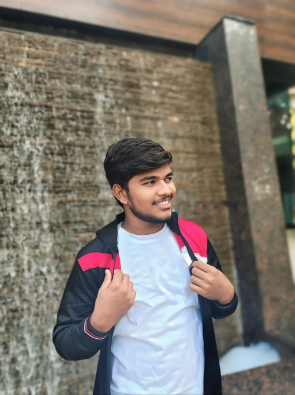
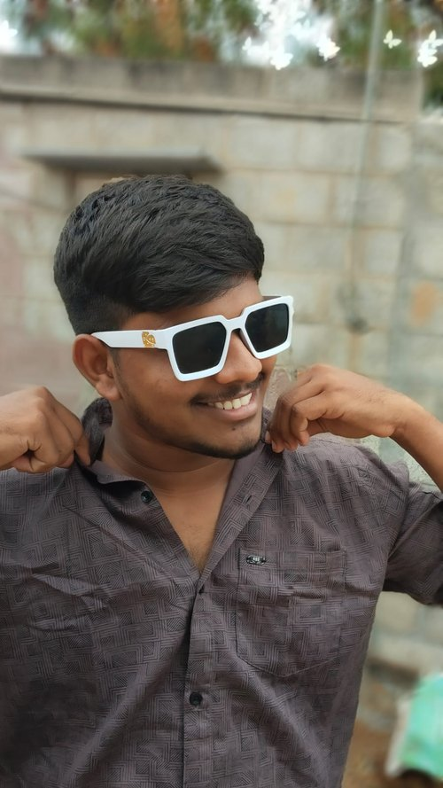

# Hi, I'm Maheshwaran 👋

**Game Developer at Sunomi AI Labs · Unity & C# · AR / VR / XR**

*Building smarter, immersive game worlds, one scene at a time.*

---

## 🙋 About me

I'm **Maheshwaran K**, from **Kallampuli**, a small village near **Kadayanallur** in **Tenkasi**, Tamil Nadu. I grew up in a farming family, and my parents still work our land back home.

I'm a tech person at heart. I've worked with **Python**, **Java**, **C#** and **Unity 3D**, and along the way I fell in love with **Unity and 3D**. Today I build games and immersive apps for a living.

🎯 **My dream:** to work on XR (AR / VR / MR) at a great company, or to build my own XR company one day.

- 💼 **Now:** Game Developer at **Sunomi AI Labs**, Bengaluru
- 🥽 **Focus:** AR / VR / XR experiences, gameplay programming, interactive 3D
- 🌱 **Learning:** spatial computing, XR interaction design, AI in games
- 📫 **Reach me:** [kmaheshwaran9965@gmail.com](mailto:kmaheshwaran9965@gmail.com)

## 💼 Experience

| Role | Company | When | Where |
|---|---|---|---|
| **Game Developer** (full-time) | Sunomi AI Labs Pvt. Ltd. | Oct 2026 – present | Bengaluru, on-site |
| **XR Developer Intern** | MH Cognition | Jun 2026 – Oct 2026 | Chennai, on-site |
| **AR / VR & Game Development Training** | ARK Infosolutions Pvt. Ltd. | During college | |

- **At MH Cognition**, I built immersive AR and VR applications in Unity and C#, implemented XR features, optimised performance and worked closely with the development team.
- **At ARK Infosolutions**, I completed intensive Unity, AR and VR training, building apps with AR Foundation and the XR Interaction Toolkit.

## 🎓 Education

| | Where | Year |
|---|---|---|
| **B.Tech, Artificial Intelligence & Data Science** (CGPA 8.1) | Dhanalakshmi Srinivasan College of Engineering, Coimbatore | 2022 – 2026 |
| **Higher Secondary (Computer Science with Maths)** | M.M. Higher Secondary School, Tenkasi | 2022 |

## 🛠️ Skills

- **Game development:** gameplay programming, game physics, UI, animation systems, level design
- **AR / VR:** plane detection, object placement, anchors, teleportation, object interaction
- **Concepts:** OOP, scene management, raycasting, collision detection, spatial computing

## 🚀 My work

### 🥽 AR / VR apps

| Project | What it is | Try it |
|---|---|---|
| [**HoloWall**](https://github.com/MAHESH21723/AR-WALL-VIDEO-PLAYER) | Scan a wall and place chroma-keyed hologram videos on it (Unity 6, AR Foundation, ARCore) | [APK](https://github.com/MAHESH21723/AR-WALL-VIDEO-PLAYER/releases/latest) |
| [**AR Car Viewer**](https://github.com/MAHESH21723/AR-Car-Viewer) | AR car showroom: place a car at real size, paint it, explode its parts, voice tour | [APK](https://github.com/MAHESH21723/AR-Car-Viewer/releases/latest) |
| [**AR Virtual Assistant**](https://github.com/MAHESH21723/AR-VIRTUAL-ASSISTANT) | "Augmented Human": an AR assistant with speech input, text-to-speech and an animated avatar | Source |
| [**Cube View**](https://github.com/MAHESH21723/Cube-View-with-code) | Interactive 3D cube viewer in the browser | [Play](https://mahesh21723.github.io/Cube-View-with-code/) |

### 🎮 Games

| Project | What it is | Try it |
|---|---|---|
| [**Echo Shift**](https://github.com/MAHESH21723/EchoShift) | Puzzle game: team up with echoes of your past self, 60 chambers in 3 sessions | [APK](https://github.com/MAHESH21723/EchoShift/releases/latest) |
| [**Pulse Arena**](https://github.com/MAHESH21723/PulseArena) | Sci-fi arena shooter with bots, weapons and timed rounds | [Download](https://github.com/MAHESH21723/PulseArena/releases/latest) |
| [**The Bouncing Orb**](https://github.com/MAHESH21723/The-Bouncing-Orb) | Mobile arcade game with a 10-level system | [APK](https://github.com/MAHESH21723/The-Bouncing-Orb/releases/latest) |
| [**Feed the Animals**](https://github.com/MAHESH21723/feed_animal) | Farmer feeds randomly spawning animals | [Play](https://mahesh21723.github.io/feed_animal/) |
| [**Truck Run**](https://github.com/MAHESH21723/basci_truck_game) | Endless runner: dodge obstacles with a truck | [Play](https://mahesh21723.github.io/basci_truck_game/) |
| [**Sky Hopper**](https://github.com/MAHESH21723/basic_plane_game) | Fly a plane through random obstacles | [Play](https://mahesh21723.github.io/basic_plane_game/) |
| [**Play Fetch**](https://github.com/MAHESH21723/dog-catch-ball) | A dog catches balls before they hit the ground | [Play](https://mahesh21723.github.io/dog-catch-ball/) |

### 🐍 Python web apps

| Project | What it is | Try it |
|---|---|---|
| [**Expense Tracker**](https://github.com/MAHESH21723/Expense-Tracker-Web-App) | Track spending, with Google Pay and bank statement import, charts and reports | [Live](https://expense-tracker-06au.onrender.com) |
| [**Speech Studio**](https://github.com/MAHESH21723/TTS-and-STT) | Text-to-speech and speech-to-text with history and exports | [Live](https://speech-studio-tts-stt.onrender.com) |
| [**Unity Asset System**](https://github.com/MAHESH21723/Unity-Asset-System) | Plans Unity games: architecture, asset lists, roadmaps and C# scripts | [Live](https://unity-asset-system.onrender.com) |
| [**Word to PDF**](https://github.com/MAHESH21723/Word-to-PDF-Converter-Web) | Converts Word documents to PDF in the browser | [Live](https://word-to-pdf-converter-9jz1.onrender.com) |
| [**Student Management**](https://github.com/MAHESH21723/Student-Management-System) | Student records with search, sorting and validation | [Live](https://student-management-system-5qj0.onrender.com) |

### 🌐 Websites

| Project | What it is | Try it |
|---|---|---|
| [**MSR Tomatoes**](https://github.com/MAHESH21723/MSR-TOMATOES) | Business website, hosted on GitHub Pages | [Visit](https://mahesh21723.github.io/MSR-TOMATOES/) |

> The Render apps run on a free plan: the first visit after a quiet spell can take up to a minute to wake up.

## 🏆 Leadership & achievements

- 🎖️ **President**, AI & DS Association (2025 – 2026)
- 🥽 **President**, Meta Fusion AR/VR Club (2025 – 2026)
- 🥇 **3+ wins** and **4+ runner-up** places in technical competitions
- 🎤 Took part in **20+** inter-college technical events and symposiums

## 📜 Certifications

- Unity Essentials Pathway · Unity
- Unity Junior Programmer · Unity
- Unity Mobile AR Development · Unity
- Unity VR Development · Unity
- Game Development Certificate · ARK Infosolutions

## 📸 Me, away from the keyboard

  
  
  

---

**Let's build something immersive together.**

[LinkedIn](https://www.linkedin.com/in/maheshwaran-k-4a6ba637a/) · [Email](mailto:kmaheshwaran9965@gmail.com) · [Instagram](https://www.instagram.com/me_maheshwaran/)

